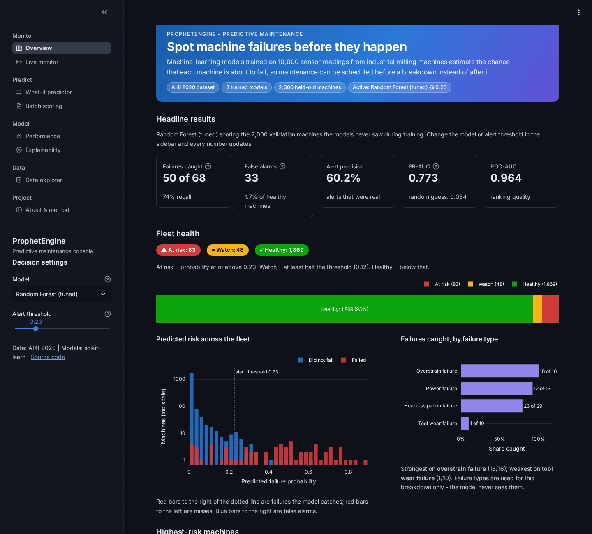
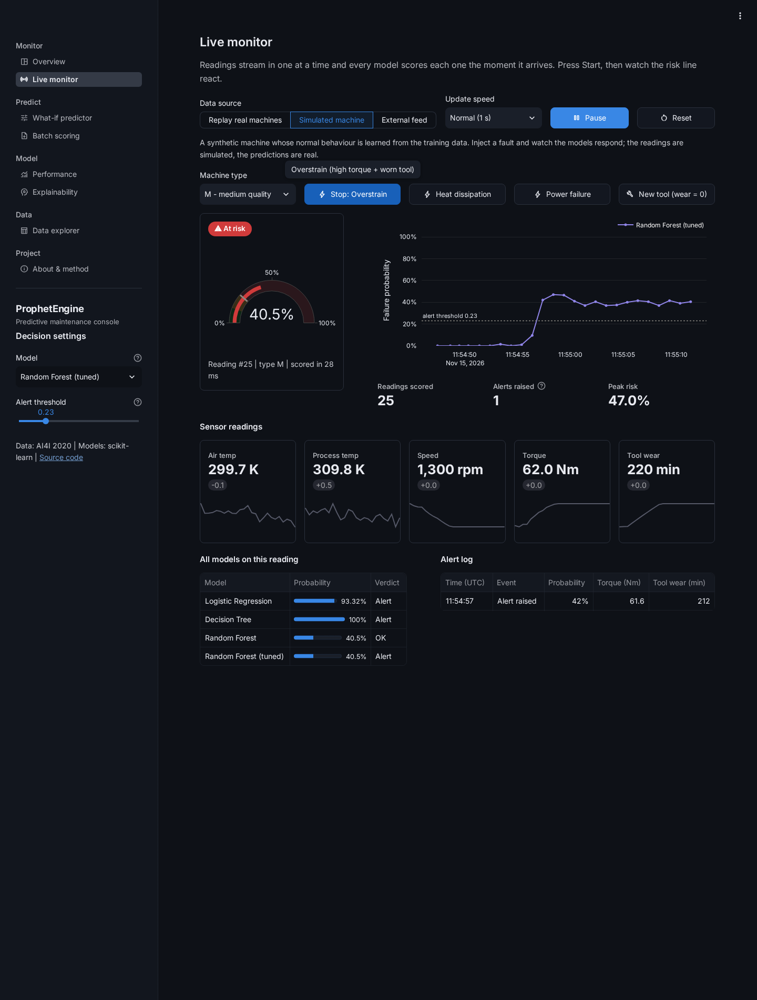
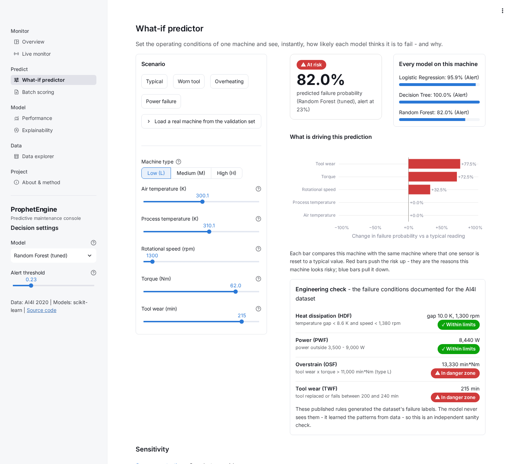
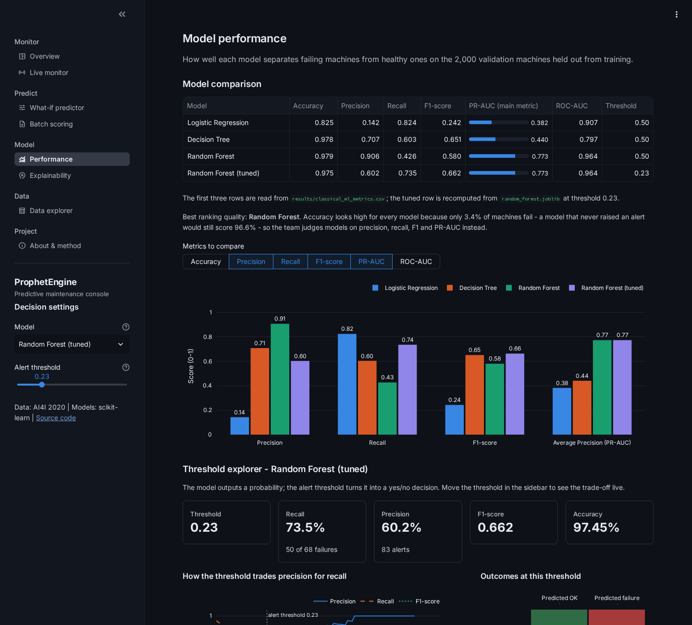
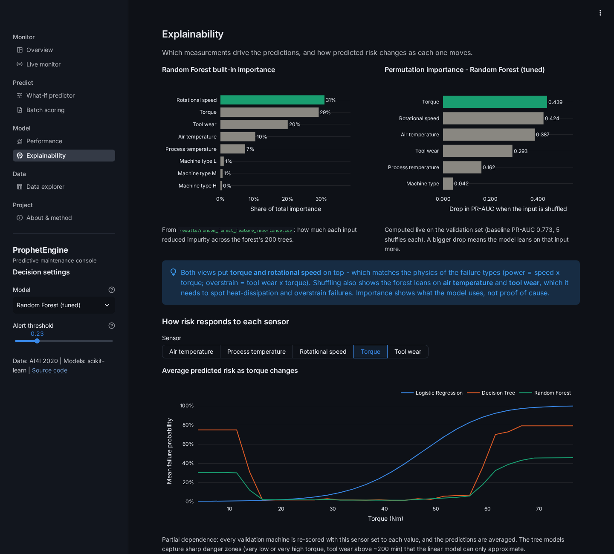

# Predictive Maintenance for Industrial Engines

## Overview

This module uses classical machine learning algorithms to predict machine failures using the AI4I 2020 Predictive Maintenance Dataset. It compares Logistic Regression, Decision Tree, and Random Forest classifiers.

## Dataset

The dataset contains sensor measurements and machine-type features.

- **Training set:** 8,000 samples
- **Validation set:** 2,000 samples
- **Target variable:** `Machine failure`
- **Features:** Air temperature, process temperature, rotational speed, torque, tool wear, and machine type.

Failure-mode columns and machine identifiers were excluded from the model inputs.

## Models Implemented

- Logistic Regression
- Decision Tree Classifier
- Random Forest Classifier
- Random Forest with a tuned classification threshold

## Results

| Model | Accuracy |
|---|---:|
| Logistic Regression | 82.50% |
| Decision Tree | 97.80% |
| Random Forest | 97.90% |
| Random Forest (Tuned Threshold: 0.23) | 97.45% |

The default Random Forest achieved the highest validation accuracy. Threshold tuning improved failure detection recall from 42.65% to 73.53%, detecting 50 out of 68 actual failures in the validation set.

## Evaluation Metrics

The models were evaluated using:

- **Accuracy:** Overall proportion of correct predictions.
- **Precision:** Proportion of predicted failures that were actual failures.
- **Recall:** Proportion of actual failures detected.
- **F1-score:** Harmonic mean of precision and recall.
- **PR-AUC (Average Precision):** Measures performance across precision-recall thresholds.
- **ROC-AUC:** Measures the model's ability to rank failures above non-failures.

## Feature Importance

The Random Forest model identified the following as its most important features:

1. Rotational speed: 30.99%
2. Torque: 29.28%
3. Tool wear: 20.04%
4. Air temperature: 10.37%
5. Process temperature: 7.32%

These values represent model feature importance, not proof of causation.

## Project Structure

```text
ProphetEngine/
├── data/
│   └── processed/
│       ├── ai4i_train.csv
│       ├── ai4i_validation.csv
│       └── ai4i_metadata.json
├── src/
│   └── models/
│       ├── classical_ml.py
│       └── tune_random_forest.py
└── results/
    ├── classical_ml_metrics.csv
    ├── random_forest_feature_importance.csv
    ├── logistic_regression_confusion_matrix.png
    ├── decision_tree_confusion_matrix.png
    └── random_forest_confusion_matrix.png
```

The `results/` directory also contains the serialized trained models.

## How to Run

Activate the virtual environment:

```bash
source venv/bin/activate
```

Install the required dependencies:

```bash
python -m pip install -r requirements.txt
```

Run the model comparison:

```bash
python src/models/classical_ml.py
```

Run Random Forest threshold tuning:

```bash
python src/models/tune_random_forest.py
```

## Dashboard

An interactive Streamlit dashboard runs the trained models live. Every number it shows is loaded or recomputed from the files in this repository (`results/*.joblib`, `results/*.csv`, `data/processed/`).



### Run it locally

```bash
python -m venv .venv
source .venv/bin/activate          # Windows: .venv\Scripts\activate
pip install -r requirements.txt
streamlit run app.py
```

Then open http://localhost:8501. Use the menu (top right) -> Settings to switch between dark and light themes.

### Pages

| Page | What it does |
|---|---|
| **Overview** | Headline results and fleet health for the 2,000 validation machines at the chosen model and alert threshold; failures caught by failure type; riskiest machines. |
| **Live monitor** | Streams readings one per second through all models: replay of real validation machines (with known outcomes), a simulated machine with fault injection, or an external feed (`data/live/stream.csv`, see `data/live/README.md`). |
| **What-if predictor** | Set the five sensors and machine type and see every model's failure probability instantly, what drives it, the dataset's documented failure rules, and sensitivity curves / a speed x torque risk map. |
| **Batch scoring** | Upload a CSV (raw AI4I, processed split or live-feed format), get it validated and scored, and download a risk-ranked worklist. Shows accuracy when labels are present. |
| **Performance** | Saved metrics plus the tuned Random Forest, threshold explorer with a cost model, precision-recall / ROC / calibration curves and recall per failure type. |
| **Explainability** | Saved feature importance, permutation importance computed on the validation set, and partial-dependence curves for all three models. |
| **Data explorer** | Filter AI4I by split, type, outcome, failure type and sensor ranges; distributions, relationships, summary statistics and CSV download. Also shows the prepared NASA C-MAPSS engine data. |
| **About & method** | Problem, data, models, leakage prevention, limitations and team. |

The model and alert threshold in the sidebar apply to every page. The default is the team's recommended setup: Random Forest with the tuned 0.23 threshold.

| | |
|---|---|
|  |  |
|  |  |

### Code layout

```text
app.py                     # entry point: page config + navigation
.streamlit/config.toml     # light and dark theme
dashboard/
├── config.py              # paths, feature names, model registry, colours
├── data.py                # loaders, upload validation, live-feed parsing (no Streamlit)
├── scoring.py             # metrics, threshold sweeps, explanations (no Streamlit)
├── simulator.py           # synthetic machine for the Live monitor
├── charts.py              # Plotly figures
├── ui.py                  # cached loaders, sidebar controls, shared components
└── views/                 # one module per page
tests/                     # pytest: helper unit tests + every page renders
```

### Tests

```bash
pip install -r requirements-dev.txt
python -m pytest
```

### Deploy to Streamlit Community Cloud

1. Go to https://share.streamlit.io and sign in with GitHub.
2. Click **Create app** -> **Deploy a public app from GitHub**.
3. Repository `roopashreejs08/ProphetEngine`, branch `main`, main file path `app.py`.
4. Under **Advanced settings**, choose Python 3.12, then **Deploy**.

The app needs no secrets. `requirements.txt` pins `scikit-learn==1.8.0`, the version the saved models were trained with.

### Deploy on Vercel

Live demo: https://prophetengine-dashboard.vercel.app

Vercel runs the dashboard as a container image built from `Dockerfile.vercel` (Container Runtime, which keeps
Streamlit's WebSocket open). With the [Vercel CLI](https://vercel.com/docs/cli), from the repository root:

```bash
vercel link                                        # once: create or pick a project
vercel project update --framework container --yes  # once: use the Container preset
vercel deploy                                      # preview deployment
vercel deploy --prod                               # production
```

Instances scale to zero after 5 minutes without traffic, so the first visit after a quiet period takes a few
seconds longer. Files written at runtime (such as the Live monitor's demo feed) are not kept between instances.

## Conclusion

The experiments show that Random Forest achieved the highest validation accuracy at 97.90% and the highest Average Precision at 0.7727. Lowering its classification threshold to 0.23 improved failure detection recall to 73.53%, with a corresponding decrease in accuracy to 97.45%.

These results are validation results. Further testing on an independent test set is recommended before making claims about generalization to unseen operational data.
